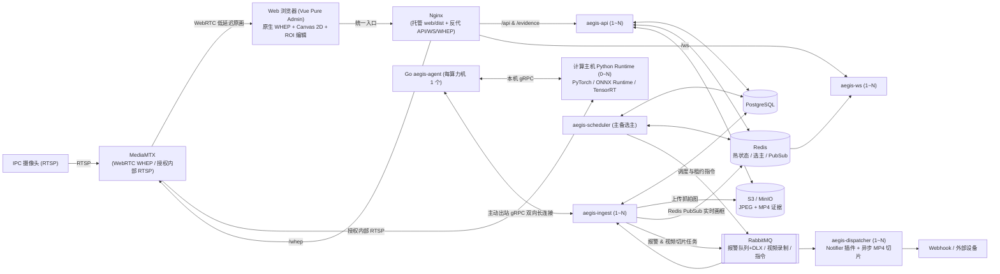

# AegisVision（宙盾视觉）

面向工业场景为主、底层逻辑通用的**低延迟视频智能分析与联动报警 Web 平台**。

AegisVision 将**低延迟视频转发**、**多节点多算法集群调度**、**区域规则引擎**与**可扩展联动报警**彻底解耦：平台团队专注工程底座与算力节点代理，算法工程师仅需使用 Python（PyTorch / ONNX Runtime / TensorRT 等）实现约定的 Runtime gRPC 协议即可快速接入上线。

> **当前阶段**：架构设计、数据库与协议规范、Go 工程规范及分阶段实施计划已定稿，代码开发尚未启动。

---

## 核心特性

- **极低延迟原始预览 + 分离叠加**：本地内网普通 RTSP 摄像头经 **MediaMTX** 免转码直出 **WebRTC (WHEP)** 原始画面（局域网延迟目标 **200~500ms**）；Web 端通过原生 **HTML5 Canvas 2D** 实时叠加检测框、类别、置信度、区域人数与 ROI 轮廓，一键开关叠加层，零服务端重编码。
- **算法版本管理与多节点集群调度**：平台统一管理算法目录、语义版本与 `runtime_key`；每台计算主机部署 1 个纯 Go 节点代理 **`aegis-agent`**，主动 gRPC 连接平台、按 `runtime_key` 启停保活多个本地 Python Runtime 进程，并通过**任务租约（Lease）**防止僵尸进程与显存泄漏。
- **按区域绑定多算法 + 三类核心规则**：每路摄像头可划定多个多边形 ROI 区域（含全画面），按“区域 × 算法版本”灵活配置规则，调度器自动按 `(camera_id, algorithm_version)` 合并去重推理任务；支持：
  - **异常命中（`anomaly_detect`）**
  - **人数统计（`count_threshold`）**
  - **离岗检测（`absence_detect`）**（配合空帧心跳计时，杜绝断流误报）
- **可扩展联动报警与 S3 证据存证**：基于 **RabbitMQ** 持久化队列（DLX 指数退避重试 + 死信兜底）与 `Notifier` 插件接口，首期内置 **Web 报警中心（含操作审计）** 与 **Webhook（HMAC-SHA256 签名）**，后续平滑扩展 MQTT、Modbus、声光、短信等通道；异常抓拍图（JPEG）与可选异步短视频证据（MP4）统一存入 **S3 兼容对象存储（内网默认 MinIO）**。
- **全链路 RBAC 与多进程水平扩展**：内置 `admin / operator / viewer` 三角色，覆盖 REST API、WebSocket、MediaMTX 播放/拉流鉴权与 HMAC 签名证据代理；Go 后端拆分为 **5 个独立平台进程 + 1 个算力机 Agent**，全部支持多实例或主备高可用。
- **离线内网双形态部署**：前端基于 **Vue Pure Admin 精简国际版（`pure-admin-thin` `i18n`）** 由 **Nginx** 独立托管反代（不内嵌 Go），支持 **Docker Compose 离线包** 与 **裸机（Linux systemd / Windows 服务）** 双部署形态。

---

## 总体架构



---

## 技术栈一览

| 层级 | 技术选型 |
| :--- | :--- |
| **Go 后端与节点 Agent** | Go 1.23+（纯 Go 无 CGO）、Gin、`pgx/v5` + `sqlc` + `goose`、gRPC（`buf` 管理 Protobuf）、`coder/websocket`、`log/slog`、AWS SDK Go v2 |
| **Web 前端与入口** | Vue Pure Admin 精简国际版（`pure-admin-thin` `i18n`：Vue 3 + TS + Vite + Element Plus + Pinia + `vue-i18n`）、原生 WHEP + Canvas 2D + SVG ROI 编辑器、**Nginx** 独立托管 |
| **算法运行时（Runtime）** | Python 3.10+（`grpcio`），自由接入 PyTorch / ONNX Runtime / TensorRT 等 |
| **流媒体与基础设施** | MediaMTX、PostgreSQL 16、RabbitMQ 3.13+、Redis 7+、MinIO（S3 兼容存储）、Nginx |
| **部署形态** | Docker Compose（支持离线镜像导出） & 裸机（Linux `systemd` / Windows 服务） |

---

## 仓库目录规划

```text
AegisVision/
├── README.md                  # 项目总览（本文件）
├── DESIGN.md                  # 架构与系统设计总纲
├── AGENTS.md                  # AI 编程代理与工程协作铁律
├── docs/                      # 详细工程设计、协议规范与实施计划
│   ├── design/
│   │   ├── 01-database-and-storage.md
│   │   ├── 02-protocols-and-apis.md
│   │   ├── 03-deployment-and-ops.md
│   │   └── 04-go-coding-standards.md
│   └── superpowers/
│       ├── specs/2026-11-26-video-ai-alarm-platform-design.md
│       └── plans/2026-11-26-phase1-implementation-plan.md
├── backend/                   # 单一 Go Module（aegis-api/scheduler/ingest/ws/dispatcher/agent）
├── web/                       # Vue Pure Admin 精简国际版前端工程
├── runtime/                   # Python Runtime gRPC SDK 与 Mock Runtime
└── deploy/                    # Docker Compose、Nginx、MediaMTX 与裸机服务脚本
```

---

## 文档导航

- **架构总纲**：[`DESIGN.md`](./DESIGN.md)
- **开发与 AI 代理约束**：[`AGENTS.md`](./AGENTS.md)
- **完整设计 Spec**：[`docs/superpowers/specs/2026-11-26-video-ai-alarm-platform-design.md`](./docs/superpowers/specs/2026-11-26-video-ai-alarm-platform-design.md)
- **数据库与 S3 存储规范**：[`docs/design/01-database-and-storage.md`](./docs/design/01-database-and-storage.md)
- **gRPC / REST / WS / MQ / Redis / Webhook 协议规范**：[`docs/design/02-protocols-and-apis.md`](./docs/design/02-protocols-and-apis.md)
- **部署拓扑、Nginx/MediaMTX 配置与运维手册**：[`docs/design/03-deployment-and-ops.md`](./docs/design/03-deployment-and-ops.md)
- **Go 工程规范与目录结构指南**：[`docs/design/04-go-coding-standards.md`](./docs/design/04-go-coding-standards.md)
- **分阶段工程实施计划（TDD）**：[`docs/superpowers/plans/2026-11-26-phase1-implementation-plan.md`](./docs/superpowers/plans/2026-11-26-phase1-implementation-plan.md)
