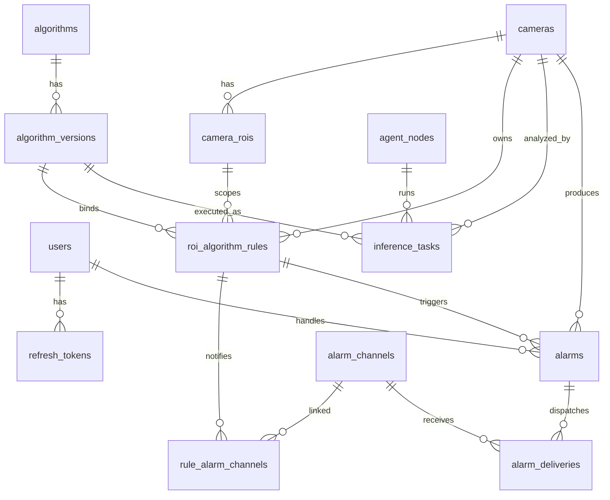

# 数据库设计与 S3 证据存储规范

- **主数据库**：PostgreSQL 16+
- **迁移工具**：`goose`（SQL 迁移文件位于 `migrations/`）
- **访问层**：`pgx/v5` + `sqlc`
- **对象存储**：S3 兼容存储（内网默认 MinIO），抽象 Go `ObjectStorage` 接口，同时支持任意 S3/OSS 及极简裸机本地目录兜底。

---

## 1. PostgreSQL 表结构总览（ER 关系）



---

## 2. 核心表结构详细设计（DDL 规范）

所有主键优先采用 `UUID`（Go 侧生成 UUIDv7，兼具全局唯一性与时间递增索引友好性）；时间字段统一使用 `TIMESTAMPTZ`（UTC 存储）。

### 2.1 用户与认证域

#### `users`
| 字段 | 类型 | 约束 | 说明 |
| :--- | :--- | :--- | :--- |
| `id` | `UUID` | `PRIMARY KEY` | 用户 ID |
| `username` | `VARCHAR(64)` | `NOT NULL UNIQUE` | 登录账号 |
| `password_hash` | `TEXT` | `NOT NULL` | Argon2id / bcrypt 密码哈希 |
| `display_name` | `VARCHAR(128)` | `NOT NULL` | 显示名称 |
| `role` | `VARCHAR(32)` | `NOT NULL CHECK (role IN ('admin','operator','viewer'))` | 角色 |
| `enabled` | `BOOLEAN` | `NOT NULL DEFAULT TRUE` | 是否启用 |
| `last_login_at` | `TIMESTAMPTZ` | `NULL` | 最近登录时间 |
| `created_at` | `TIMESTAMPTZ` | `NOT NULL DEFAULT NOW()` | 创建时间 |
| `updated_at` | `TIMESTAMPTZ` | `NOT NULL DEFAULT NOW()` | 更新时间 |

#### `refresh_tokens`
| 字段 | 类型 | 约束 | 说明 |
| :--- | :--- | :--- | :--- |
| `id` | `UUID` | `PRIMARY KEY` | Token 记录 ID |
| `user_id` | `UUID` | `NOT NULL REFERENCES users(id) ON DELETE CASCADE` | 所属用户 |
| `token_hash` | `CHAR(64)` | `NOT NULL UNIQUE` | Refresh Token SHA-256 摘要 |
| `expires_at` | `TIMESTAMPTZ` | `NOT NULL` | 过期时间 |
| `revoked_at` | `TIMESTAMPTZ` | `NULL` | 吊销时间 |
| `created_at` | `TIMESTAMPTZ` | `NOT NULL DEFAULT NOW()` | 签发时间 |

索引：`idx_refresh_tokens_user_id (user_id)`、`idx_refresh_tokens_expires_at (expires_at)`。

---

### 2.2 算法与版本管理域

#### `algorithms`
| 字段 | 类型 | 约束 | 说明 |
| :--- | :--- | :--- | :--- |
| `id` | `UUID` | `PRIMARY KEY` | 算法 ID |
| `algorithm_key` | `VARCHAR(64)` | `NOT NULL UNIQUE` | 唯一算法标识（如 `person_detect`、`helmet_detect`） |
| `name` | `VARCHAR(128)` | `NOT NULL` | 算法展示名 |
| `description` | `TEXT` | `NOT NULL DEFAULT ''` | 功能说明 |
| `supported_labels` | `JSONB` | `NOT NULL DEFAULT '[]'` | 声明输出的标签清单（如 `["person","no_helmet"]`） |
| `created_at` | `TIMESTAMPTZ` | `NOT NULL DEFAULT NOW()` | 创建时间 |
| `updated_at` | `TIMESTAMPTZ` | `NOT NULL DEFAULT NOW()` | 更新时间 |

#### `algorithm_versions`
| 字段 | 类型 | 约束 | 说明 |
| :--- | :--- | :--- | :--- |
| `id` | `UUID` | `PRIMARY KEY` | 版本 ID |
| `algorithm_id` | `UUID` | `NOT NULL REFERENCES algorithms(id) ON DELETE RESTRICT` | 所属算法 |
| `version` | `VARCHAR(64)` | `NOT NULL` | 语义版本号（如 `v1.2.0`） |
| `runtime_key` | `VARCHAR(128)` | `NOT NULL` | 对应计算主机上的 Runtime 键（如 `py-yolo-v2`） |
| `launch_spec` | `JSONB` | `NOT NULL DEFAULT '{}'` | Agent 启停参考规格（如默认参数、资源权重、模型路径标识） |
| `default_params` | `JSONB` | `NOT NULL DEFAULT '{}'` | 下发给 Runtime 的默认算法参数（如 `target_fps`、`conf_threshold`） |
| `status` | `VARCHAR(32)` | `NOT NULL CHECK (status IN ('draft','active','deprecated'))` | 发布状态 |
| `created_at` | `TIMESTAMPTZ` | `NOT NULL DEFAULT NOW()` | 创建时间 |
| `updated_at` | `TIMESTAMPTZ` | `NOT NULL DEFAULT NOW()` | 更新时间 |

约束：`UNIQUE (algorithm_id, version)`；索引：`idx_algo_versions_runtime_key (runtime_key)`。

---

### 2.3 摄像头、ROI 与区域规则域

#### `cameras`
| 字段 | 类型 | 约束 | 说明 |
| :--- | :--- | :--- | :--- |
| `id` | `UUID` | `PRIMARY KEY` | 摄像头 ID |
| `name` | `VARCHAR(128)` | `NOT NULL` | 摄像头名称 |
| `location` | `VARCHAR(256)` | `NOT NULL DEFAULT ''` | 车间/点位位置 |
| `rtsp_url` | `TEXT` | `NOT NULL` | 主码流 RTSP 地址 |
| `sub_stream_url` | `TEXT` | `NOT NULL DEFAULT ''` | 可选子码流 RTSP 地址（用于多宫格低解码压力预览） |
| `stream_path` | `VARCHAR(128)` | `NOT NULL UNIQUE` | MediaMTX 路径名（如 `cam_<short_id>`） |
| `codec_hint` | `VARCHAR(16)` | `NOT NULL DEFAULT 'h264'` | `h264` / `h265`（决定是否启用可选转码提示） |
| `status` | `VARCHAR(32)` | `NOT NULL DEFAULT 'offline'` | `offline` / `online` / `error` |
| `enabled` | `BOOLEAN` | `NOT NULL DEFAULT TRUE` | 启用开关 |
| `created_at` | `TIMESTAMPTZ` | `NOT NULL DEFAULT NOW()` | 创建时间 |
| `updated_at` | `TIMESTAMPTZ` | `NOT NULL DEFAULT NOW()` | 更新时间 |

#### `camera_rois`
| 字段 | 类型 | 约束 | 说明 |
| :--- | :--- | :--- | :--- |
| `id` | `UUID` | `PRIMARY KEY` | ROI ID |
| `camera_id` | `UUID` | `NOT NULL REFERENCES cameras(id) ON DELETE CASCADE` | 所属摄像头 |
| `name` | `VARCHAR(128)` | `NOT NULL` | 区域名称（如“冲压禁区”、“1号工位”） |
| `roi_type` | `VARCHAR(32)` | `NOT NULL CHECK (roi_type IN ('polygon','full_frame'))` | 多边形或全画面 |
| `points` | `JSONB` | `NOT NULL DEFAULT '[]'` | 归一化顶点数组 `[{"x":0.1,"y":0.2}, ...]`（坐标范围 `0.0~1.0`） |
| `enabled` | `BOOLEAN` | `NOT NULL DEFAULT TRUE` | 是否启用 |
| `created_at` | `TIMESTAMPTZ` | `NOT NULL DEFAULT NOW()` | 创建时间 |
| `updated_at` | `TIMESTAMPTZ` | `NOT NULL DEFAULT NOW()` | 更新时间 |

索引：`idx_camera_rois_camera_id (camera_id)`。

#### `roi_algorithm_rules`
| 字段 | 类型 | 约束 | 说明 |
| :--- | :--- | :--- | :--- |
| `id` | `UUID` | `PRIMARY KEY` | 规则 ID |
| `camera_id` | `UUID` | `NOT NULL REFERENCES cameras(id) ON DELETE CASCADE` | 冗余摄像头 ID 便于快速索引 |
| `roi_id` | `UUID` | `NOT NULL REFERENCES camera_rois(id) ON DELETE CASCADE` | 所属区域 |
| `algorithm_version_id` | `UUID` | `NOT NULL REFERENCES algorithm_versions(id) ON DELETE RESTRICT` | 绑定的算法版本 |
| `name` | `VARCHAR(128)` | `NOT NULL` | 规则名称 |
| `rule_mode` | `VARCHAR(32)` | `NOT NULL CHECK (rule_mode IN ('anomaly_detect','count_threshold','absence_detect'))` | 三类规则模式 |
| `params` | `JSONB` | `NOT NULL` | 规则判定参数（详见下方 JSONB Schema） |
| `algo_params_override` | `JSONB` | `NOT NULL DEFAULT '{}'` | 透传给 Runtime 的算法参数覆盖项 |
| `schedule_mode` | `VARCHAR(32)` | `NOT NULL DEFAULT 'auto' CHECK (schedule_mode IN ('auto','pinned'))` | 自动调度或指定节点 |
| `pinned_node_id` | `VARCHAR(128)` | `NULL` | `pinned` 模式下的指定节点 ID |
| `record_video` | `BOOLEAN` | `NOT NULL DEFAULT FALSE` | 是否异步录制短视频证据 |
| `video_pre_seconds` | `INT` | `NOT NULL DEFAULT 5` | 报警前录制秒数 |
| `video_post_seconds` | `INT` | `NOT NULL DEFAULT 5` | 报警后录制秒数 |
| `enabled` | `BOOLEAN` | `NOT NULL DEFAULT TRUE` | 启用开关 |
| `created_at` | `TIMESTAMPTZ` | `NOT NULL DEFAULT NOW()` | 创建时间 |
| `updated_at` | `TIMESTAMPTZ` | `NOT NULL DEFAULT NOW()` | 更新时间 |

**`roi_algorithm_rules.params` 标准 JSONB Schema**：
```json
{
  "labels": ["person"],
  "require_is_abnormal": false,
  "min_confidence": 0.55,
  "hit_point": "bottom_center",
  "min_count": 1,
  "max_count": 5,
  "consecutive_frames": 3,
  "duration_seconds": 10,
  "cooldown_seconds": 30,
  "heartbeat_timeout_seconds": 5,
  "severity": "warning"
}
```
- `hit_point`：`bottom_center`（默认）/ `center` / `bbox_intersect`。
- `anomaly_detect`：使用 `labels` / `require_is_abnormal`、`min_confidence`、`consecutive_frames`、`duration_seconds`、`cooldown_seconds`。
- `count_threshold`：使用 `labels`、`min_confidence`、`min_count`（可选）、`max_count`（可选）、`duration_seconds`、`cooldown_seconds`。
- `absence_detect`：使用 `labels`、`min_confidence`、`min_count`（默认 `1`，即 `count < 1` 视为无人）、`duration_seconds`（离岗持续秒数）、`heartbeat_timeout_seconds`（超时停表防误报）、`cooldown_seconds`。

索引：`idx_rules_camera_enabled (camera_id, enabled)`、`idx_rules_algo_version (algorithm_version_id)`。

---

### 2.4 节点集群与租约任务域

#### `agent_nodes`
| 字段 | 类型 | 约束 | 说明 |
| :--- | :--- | :--- | :--- |
| `node_id` | `VARCHAR(128)` | `PRIMARY KEY` | 计算主机唯一标识 |
| `hostname` | `VARCHAR(128)` | `NOT NULL` | 主机名 |
| `ip_addr` | `VARCHAR(64)` | `NOT NULL` | 内网 IP |
| `runtime_keys` | `JSONB` | `NOT NULL DEFAULT '[]'` | 本机可用 `runtime_key` 清单 |
| `max_tasks` | `INT` | `NOT NULL DEFAULT 8` | 最大并发任务上限 |
| `running_tasks` | `INT` | `NOT NULL DEFAULT 0` | 当前运行任务数 |
| `status` | `VARCHAR(32)` | `NOT NULL DEFAULT 'offline'` | `online` / `offline` / `draining` |
| `meta` | `JSONB` | `NOT NULL DEFAULT '{}'` | GPU/CPU/内存/版本号上报快照 |
| `last_heartbeat_at` | `TIMESTAMPTZ` | `NULL` | 最近心跳时间 |
| `created_at` | `TIMESTAMPTZ` | `NOT NULL DEFAULT NOW()` | 首次注册时间 |
| `updated_at` | `TIMESTAMPTZ` | `NOT NULL DEFAULT NOW()` | 更新时间 |

#### `inference_tasks`
| 字段 | 类型 | 约束 | 说明 |
| :--- | :--- | :--- | :--- |
| `id` | `UUID` | `PRIMARY KEY` | 推理任务 ID |
| `camera_id` | `UUID` | `NOT NULL REFERENCES cameras(id) ON DELETE CASCADE` | 目标摄像头 |
| `algorithm_version_id` | `UUID` | `NOT NULL REFERENCES algorithm_versions(id) ON DELETE RESTRICT` | 目标算法版本 |
| `runtime_key` | `VARCHAR(128)` | `NOT NULL` | 归属 Runtime 键 |
| `assigned_node_id` | `VARCHAR(128)` | `NULL REFERENCES agent_nodes(node_id) ON DELETE SET NULL` | 调度分配的计算主机 |
| `ingest_instance_id` | `VARCHAR(128)` | `NOT NULL DEFAULT ''` | 持有该节点连接的 `aegis-ingest` 实例 ID |
| `desired_state` | `VARCHAR(32)` | `NOT NULL CHECK (desired_state IN ('running','stopped'))` | 期望状态 |
| `actual_state` | `VARCHAR(32)` | `NOT NULL DEFAULT 'pending'` | `pending` / `running` / `reconnecting` / `failed` / `stopped` |
| `lease_id` | `UUID` | `NULL` | 当前有效租约 ID |
| `lease_expires_at` | `TIMESTAMPTZ` | `NULL` | 租约到期时间 |
| `config_version` | `BIGINT` | `NOT NULL DEFAULT 1` | ROI/参数变更递增版本号 |
| `last_frame_at` | `TIMESTAMPTZ` | `NULL` | 最近收到有效帧/空帧心跳时间 |
| `error_message` | `TEXT` | `NOT NULL DEFAULT ''` | 最近错误信息 |
| `created_at` | `TIMESTAMPTZ` | `NOT NULL DEFAULT NOW()` | 创建时间 |
| `updated_at` | `TIMESTAMPTZ` | `NOT NULL DEFAULT NOW()` | 更新时间 |

约束：部分唯一索引 `CREATE UNIQUE INDEX uq_active_task_cam_ver ON inference_tasks (camera_id, algorithm_version_id) WHERE desired_state = 'running';`（从数据库层彻底防止同一摄像头×算法版本重复下发任务）。

---

### 2.5 报警记录与可扩展投递域

#### `alarm_channels` & `rule_alarm_channels`
- `alarm_channels`：`id (UUID PK)`、`name (VARCHAR 128)`、`channel_type (VARCHAR 32，首期 'webhook')`、`config (JSONB)`、`enabled (BOOLEAN)`、`created_at`、`updated_at`。
- `rule_alarm_channels`：`rule_id (UUID FK)`、`channel_id (UUID FK)`，联合主键 `(rule_id, channel_id)`。

**Webhook `config` JSONB Schema**：
```json
{
  "url": "http://192.168.10.50:9000/alarm-hook",
  "method": "POST",
  "headers": { "X-Custom-Source": "plant-a" },
  "secret": "optional-hmac-sha256-secret",
  "timeout_ms": 5000,
  "include_evidence_urls": true
}
```

#### `alarms`
| 字段 | 类型 | 约束 | 说明 |
| :--- | :--- | :--- | :--- |
| `id` | `UUID` | `PRIMARY KEY` | 报警 ID |
| `event_dedup_key` | `VARCHAR(128)` | `NULL UNIQUE` | 幂等去重键（承接 Agent 离线续传重放保护） |
| `camera_id` | `UUID` | `NOT NULL REFERENCES cameras(id)` | 摄像头 ID |
| `roi_id` | `UUID` | `NULL REFERENCES camera_rois(id) ON DELETE SET NULL` | 触发区域 ID |
| `rule_id` | `UUID` | `NULL REFERENCES roi_algorithm_rules(id) ON DELETE SET NULL` | 触发规则 ID |
| `algorithm_version_id` | `UUID` | `NULL REFERENCES algorithm_versions(id) ON DELETE SET NULL` | 算法版本 ID |
| `rule_mode` | `VARCHAR(32)` | `NOT NULL` | `anomaly_detect` / `count_threshold` / `absence_detect` |
| `title` | `VARCHAR(256)` | `NOT NULL` | 报警摘要标题 |
| `severity` | `VARCHAR(16)` | `NOT NULL DEFAULT 'warning'` | `info` / `warning` / `critical` |
| `triggered_at` | `TIMESTAMPTZ` | `NOT NULL` | 异常实际发生时间戳 |
| `detected_count` | `INT` | `NOT NULL DEFAULT 0` | 触发瞬间区域内目标计数 |
| `detections_snapshot` | `JSONB` | `NOT NULL DEFAULT '[]'` | 触发瞬间检测框快照（供详情叠加还原） |
| `roi_snapshot` | `JSONB` | `NOT NULL DEFAULT '{}'` | 触发瞬间 ROI 顶点快照（防后续编辑区域导致历史错位） |
| `image_object_key` | `TEXT` | `NOT NULL DEFAULT ''` | S3 抓拍图 Object Key |
| `video_object_key` | `TEXT` | `NOT NULL DEFAULT ''` | S3 短视频证据 Object Key |
| `video_status` | `VARCHAR(16)` | `NOT NULL DEFAULT 'none'` | `none` / `recording` / `ready` / `failed` |
| `handle_status` | `VARCHAR(32)` | `NOT NULL DEFAULT 'unhandled'` | `unhandled` / `confirmed` / `false_positive` |
| `handled_by` | `UUID` | `NULL REFERENCES users(id) ON DELETE SET NULL` | 处理人 |
| `handled_at` | `TIMESTAMPTZ` | `NULL` | 处理时间 |
| `handle_note` | `TEXT` | `NOT NULL DEFAULT ''` | 处理备注 |
| `created_at` | `TIMESTAMPTZ` | `NOT NULL DEFAULT NOW()` | 入库时间 |

索引：`idx_alarms_triggered_at (triggered_at DESC)`、`idx_alarms_camera_time (camera_id, triggered_at DESC)`、`idx_alarms_handle_status (handle_status, triggered_at DESC)`。

#### `alarm_deliveries`
| 字段 | 类型 | 约束 | 说明 |
| :--- | :--- | :--- | :--- |
| `id` | `UUID` | `PRIMARY KEY` | 投递记录 ID |
| `alarm_id` | `UUID` | `NOT NULL REFERENCES alarms(id) ON DELETE CASCADE` | 关联报警 |
| `channel_id` | `UUID` | `NOT NULL REFERENCES alarm_channels(id) ON DELETE CASCADE` | 关联报警通道 |
| `channel_type` | `VARCHAR(32)` | `NOT NULL` | 通道类型 |
| `status` | `VARCHAR(32)` | `NOT NULL DEFAULT 'pending'` | `pending` / `success` / `failed` / `dead_letter` |
| `attempts` | `INT` | `NOT NULL DEFAULT 0` | 已尝试次数 |
| `max_attempts` | `INT` | `NOT NULL DEFAULT 4` | 最大尝试次数（首次 + 3 次重试） |
| `last_status_code` | `INT` | `NOT NULL DEFAULT 0` | 最近 HTTP 响应码 |
| `last_latency_ms` | `INT` | `NOT NULL DEFAULT 0` | 最近耗时（毫秒） |
| `last_error` | `TEXT` | `NOT NULL DEFAULT ''` | 最近失败详情 |
| `created_at` | `TIMESTAMPTZ` | `NOT NULL DEFAULT NOW()` | 创建时间 |
| `updated_at` | `TIMESTAMPTZ` | `NOT NULL DEFAULT NOW()` | 更新时间 |

索引：`idx_deliveries_alarm_id (alarm_id)`、`idx_deliveries_status (status, updated_at)`。

---

## 3. S3 对象存储规范（内网默认 MinIO）

### 3.1 Bucket 与路径规划
- 默认 Bucket：`aegis-evidence`（私有访问权限，不开放匿名公读）。
- Object Key 规范（按日期分层，方便定位与生命周期策略管理）：
  - 抓拍图：`images/YYYY/MM/DD/{camera_id}/{alarm_id}.jpg`（`Content-Type: image/jpeg`）
  - 短视频：`videos/YYYY/MM/DD/{camera_id}/{alarm_id}.mp4`（`Content-Type: video/mp4`，写入时建议加 `-movflags +faststart` 支持浏览器秒开拖拽播放）

### 3.2 生命周期策略（自动防爆盘）
通过 S3 Bucket Lifecycle 规则按前缀自动过期清理（无需自研定时删文件任务）：
- 前缀 `images/`：默认保留 **90 天**（可按现场磁盘容量调整）。
- 前缀 `videos/`：默认保留 **30 天**（可按现场磁盘容量调整）。

### 3.3 Go `ObjectStorage` 统一抽象接口
```go
type ObjectStorage interface {
    PutObject(ctx context.Context, key string, r io.Reader, size int64, contentType string) error
    GetObject(ctx context.Context, key string, rangeHeader string) (io.ReadCloser, ObjectMeta, error)
    DeleteObject(ctx context.Context, key string) error
}
```
- **生产默认驱动 (`s3`)**：基于 `aws-sdk-go-v2/service/s3`，启用 `UsePathStyle: true` 完美兼容 MinIO 与标准 S3/OSS。
- **极简裸机可选驱动 (`local`)**：支持在极简单机裸机环境退化写入指定本地目录，业务代码零感知切换。

### 3.4 安全证据访问（签名代理链接）
- 外部系统与前端统一通过 Nginx 入口访问：`GET /api/v1/evidence/{alarm_id}/image` 与 `GET /api/v1/evidence/{alarm_id}/video`：
  - **已登录浏览器**：携带 JWT Access Token 访问；
  - **外部 Webhook 接收方**：携带 URL 签名参数 `?exp=<unix_ts>&sig=<hmac_sha256(secret, alarm_id + ":" + kind + ":" + exp)>`（默认有效期 24 小时，可配置），校验通过后由 `aegis-api` 直接从 S3 透传流式返回，并完整透传 `Range` / `Content-Range` / `Accept-Ranges` 头支持 MP4 进度条拖拽播放。
